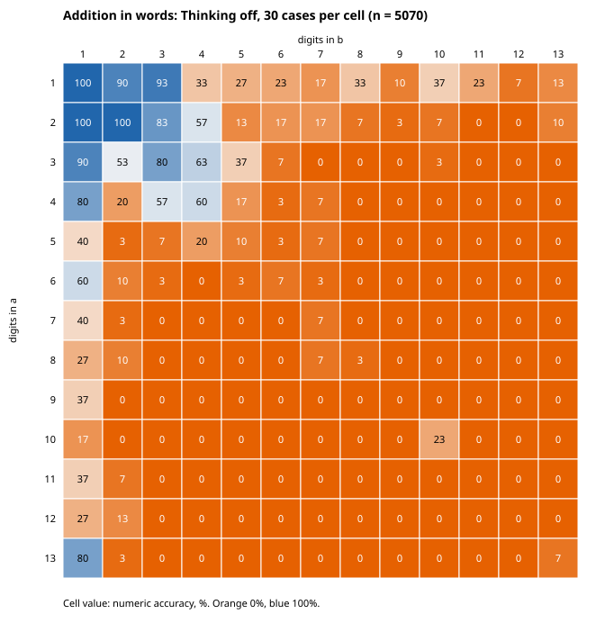
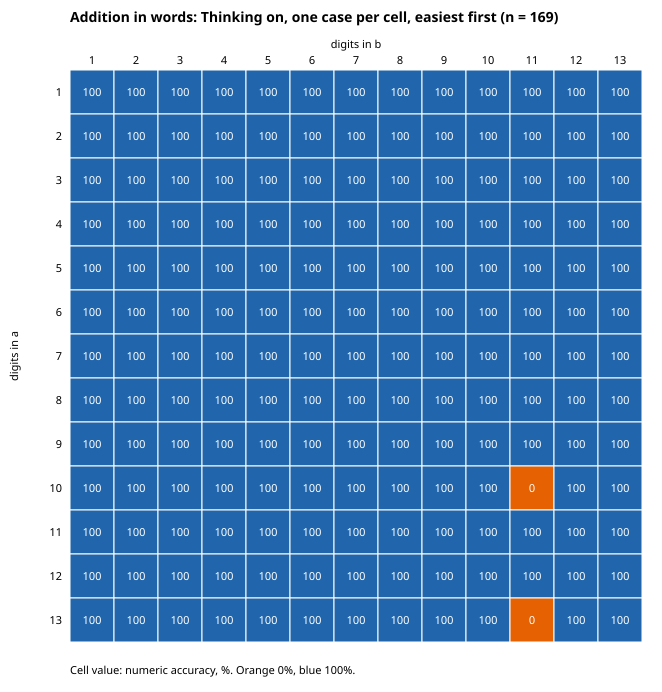

# Diffusion model addition in words

This experiment repeats Simon Willison's
[Qwen3.8 27B addition-in-words test](https://github.com/simonw/research/tree/main/qwen38-addition-in-words)
on our hosted diffusion model. That test was inspired by
[Colin Fraser's Bluesky post](https://bsky.app/profile/colin-fraser.net/post/3mwopbyznhs2k).
It checks whether the model can add two positive integers and return the result
entirely in English words.

Every prompt uses the same template as the original:

> What is `{a}` + `{b}`? Please write your answer in words. Do not include any
> other text or information, just the answer in words.

Two configurations were evaluated, matching the original:

1. A complete thinking-disabled benchmark with 30 sampled additions in every
   ordered combination of one- through thirteen-digit operands: 169 cells and
   5,070 prompts.
2. A paired thinking-enabled benchmark using the same `r01` case from every
   cell: 169 prompts total, ordered from easiest to hardest.

The cases are the original run's frozen `pairs.csv`, checked against its
SHA-256, so every row joins to the Qwen3.8 27B results by `case_id`. Both runs
took place on 2026-10-11.

## Results

The full thinking-disabled benchmark scored **606/5,070 (11.95%)**, about half
of Qwen3.8 27B's 23.57%. Only **57.10%** of responses were valid English
numbers. 1,565 answers (30.87%) contained the word "plus", mostly restating
the problem as "*a* plus *b* equals *c*", which the strict grader fails.
That is not the main loss, though: 2,289 answers were well-formed numbers for the wrong integer. Accuracy fell
from 87.78% when the longer operand had one to three digits to 3.56% at ten to
thirteen digits.

With thinking on, the model scored **167/169 (98.82%)**, the same as Qwen3.8
27B with medium reasoning, at a median 1.56 seconds per request.

For the paired comparison, both configurations were evaluated on the exact same
169 additions:

| Measure | No thinking | Thinking | Change |
| --- | ---: | ---: | ---: |
| Numeric correctness | 14/169 (8.28%) | 167/169 (98.82%) | +90.53 percentage points |
| Instruction compliance | 93/169 (55.03%) | 169/169 (100.00%) | +44.97 percentage points |
| Canonical wording | 14/169 (8.28%) | 166/169 (98.22%) | +89.94 percentage points |
| Median latency | 0.20 seconds | 1.56 seconds | — |
| Mean latency | 0.28 seconds | 2.01 seconds | — |
| Median completion tokens | 19 | 784 | — |
| Total completion tokens | 3,909 | 192,301 | — |
| Median reasoning tokens | 0 | 764 | — |

Of those 169 cases, both configurations answered 14 correctly, thinking alone
answered 153, no thinking alone answered none, and both missed two.

In both thinking-enabled failures the reasoning reached the correct digits and
the error came in converting them to words:

- `8,810,047,276 + 22,521,053,259 = 31,331,100,535`. The answer said "one
  hundred five thousand", which is 105,000 rather than 100,000, giving
  31,331,105,535.
- `9,558,190,671,365 + 35,576,416,769 = 9,593,767,088,134`. The answer said
  "eight hundred eighty-eight thousand" for the `088` group, giving
  9,593,767,888,134.

## Against Qwen3.8 27B

Same cases, same prompt, same grading rules. The Qwen3.8 numbers come from the
original README and its `results.csv`. Latency is not comparable: different
hardware, server, and network path.

| Measure | Qwen3.8 27B, no thinking | Ours, no thinking | Qwen3.8 27B, medium reasoning | Ours, thinking |
| --- | ---: | ---: | ---: | ---: |
| Full benchmark correctness (5,070) | 1,195 (23.57%) | 606 (11.95%) | — | — |
| Full benchmark valid English numbers | 96.17% | 57.10% | — | — |
| Paired correctness (169) | 45 (26.63%) | 14 (8.28%) | 167 (98.82%) | 167 (98.82%) |
| Paired instruction compliance (169) | 164 (97.04%) | 93 (55.03%) | 168 (99.41%) | 169 (100.00%) |
| Paired median completion tokens | 14 | 19 | 313 | 784 |
| Paired median latency | 1.50 s | 0.20 s | 27.62 s | 1.56 s |

Our thinking run used 2.5 times Qwen3.8's median tokens yet finished faster,
since the server and hardware differ. That speed is not attributable to
diffusion from this test alone.

## Accuracy grids

Cell value is numeric accuracy in percent, orange for 0% through blue for 100%.

### Thinking disabled: 30 cases per cell



### Thinking enabled: one case per cell



Because the thinking-enabled run has one case per cell, each cell in its grid
is either 0% or 100%.

## Method

Operand lengths range independently from one through thirteen digits. The
original sampled 30 pairs with replacement per ordered digit-length cell using
seed `20260929`, excluding zero, and shuffled with seed `20260930`. We reuse
those frozen cases in that shuffled order. The thinking-enabled run takes
replicate `r01` from each cell and orders them easiest first with the original's
sort key.

Both configurations use greedy decoding:

- `temperature=0`
- `top_k=-1` (SGLang's value for disabled; the original's llama-server used `0`)
- `top_p=1`
- `min_p=0`
- `repetition_penalty=1`
- a per-case `seed` derived from the `case_id`, as in the original

Thinking-disabled requests set `chat_template_kwargs.enable_thinking=false` and
allow up to 128 completion tokens. Thinking-enabled requests set
`enable_thinking=true` and `max_tokens=32000`. The original used
`max_tokens=-1` on a 32,768-token context. SGLang rejects `-1`, so 32,000
approximates the same budget. No thinking-enabled request came near it; all 169
stopped naturally. The original also sent `reasoning_effort=medium`. We did not
send it. Whether this server honors it is untested.

A response counts as numerically correct only if its complete visible content
parses as valid English number words and represents exactly `a + b`. Digits,
explanations, markup, extra prose, malformed number phrases, and valid phrases
for the wrong number all fail. Reasoning content is saved but never used to
rescue a grade. Our grader is an independent implementation of the original's
rules and passes the same self-test cases.

All 5,070 thinking-disabled and all 169 thinking-enabled requests completed on
their first HTTP attempt. Two thinking-disabled answers hit the 128-token cap.
There were no empty answers and no thinking-tag leakage in visible content.
Requests were sent one at a time.

## Model and machine

| Item | Value |
| --- | --- |
| Served model ID | `qwen36-iter22000-blk16-arverify-best` |
| Base model | Qwen3.6 35B-A3B (from the server's model path) |
| Checkpoint | iteration 22,000 (from the server's model path) |
| Precision | `dtype=auto`, no quantization |
| Decoding | SGLang `speculative_algorithm=DLLM`: 16-token diffusion blocks drafted and verified by the same model |
| Draft acceptance | `dllm_spec_accept_rule=medusa`, ratio 0.9, delta 0.6 |
| Server | SGLang `0.0.0.dev13504+g11de4bf7f`, OpenAI-compatible `/v1/chat/completions` |
| Hardware | Not exposed by the server |
| Context | 131,072 tokens |
| Server slots | 16 (`max_running_requests`); client sent one request at a time |

The full server configuration is in each run's `server_info.json`.

The acceptance rule is `medusa`, not exact match, so the visible output need
not equal what the same weights would produce under plain AR decoding.

The model introduces itself as "Step" from StepFun when asked, despite the
Qwen base. Treat its self-reports as unreliable.

## Caveats

- As in the original, the paired result compares two complete configurations,
  not reasoning alone. The completion limit changes along with thinking, and so
  does execution order.
- The thinking-enabled condition has one case per cell, far smaller than the
  30-per-cell thinking-disabled benchmark.
- The metric combines arithmetic, number-to-words conversion, and instruction
  following. Thinking-disabled scores are hurt by both bad arithmetic and the
  restated-equation format.
- The server is remote and may be shared. Latency includes the network path
  and any other load on it at the time.
- Results apply only to this checkpoint, chat template, server build, prompt,
  and decoding settings.

## Files

- `addition_in_words.py`: runner, grader, summarizer, and SVG heatmap.
  Standard library only.
- `results/thinking-off-full/`: the 5,070-case thinking-disabled run.
- `results/thinking-on-one-per-cell-easiest-first/`: the 169-case
  thinking-enabled run.
- `results/comparison.json`: the paired table, overlap counts, thinking-enabled
  failures, and the full-benchmark comparison with Qwen3.8 27B.

Within each run directory:

| File | Purpose |
| --- | --- |
| `manifest.json` | Experiment definition, request template, hashes, server identity |
| `cases.csv` | The frozen cases in request order |
| `attempts.jsonl` | Complete request and response records |
| `results.csv` | One graded row per case |
| `summary.json` | Machine-readable headline results |
| `cell_accuracy.csv`, `accuracy_matrix.csv` | Grid-level results |
| `heatmap.svg` | Rendered result grid |
| `server_info.json`, `server_models.json` | Runtime provenance |
| `smoke.jsonl` | Smoke-test requests sent before the run |
| `run.log` | Progress log |

The upstream `pairs.csv` and `results.csv` are downloaded into `results/` on
demand and are not committed.

## Reproduction

Set `DIFFUSION_BASE_URL` in the repository's `.env.local`. It may be the server
root, `/v1`, or the full `/v1/chat/completions` URL. Then, from this directory:

```bash
python3 addition_in_words.py self-test
python3 addition_in_words.py prepare --config off
python3 addition_in_words.py smoke --config off
python3 addition_in_words.py run --config off
python3 addition_in_words.py summarize --config off
```

Repeat with `--config on` for the thinking-enabled run, then:

```bash
python3 addition_in_words.py compare
```

The runner resumes from `attempts.jsonl` and skips cases that already have a
successful response. Use a fresh results directory for an independent repeat.
