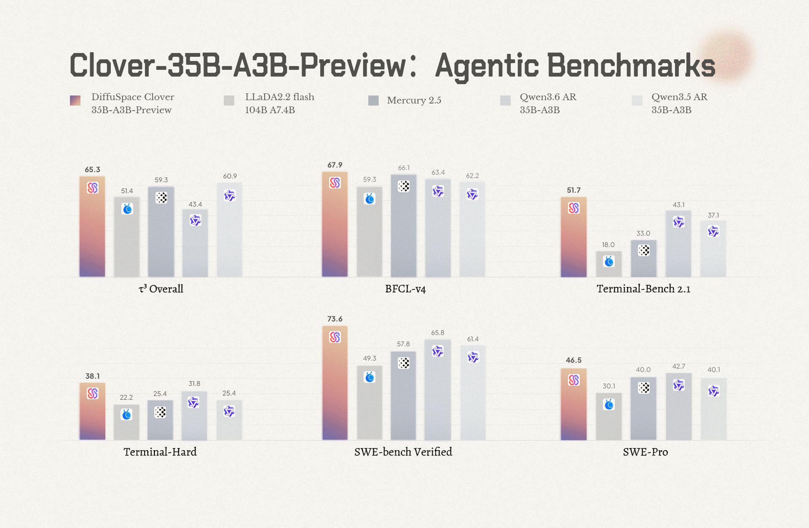
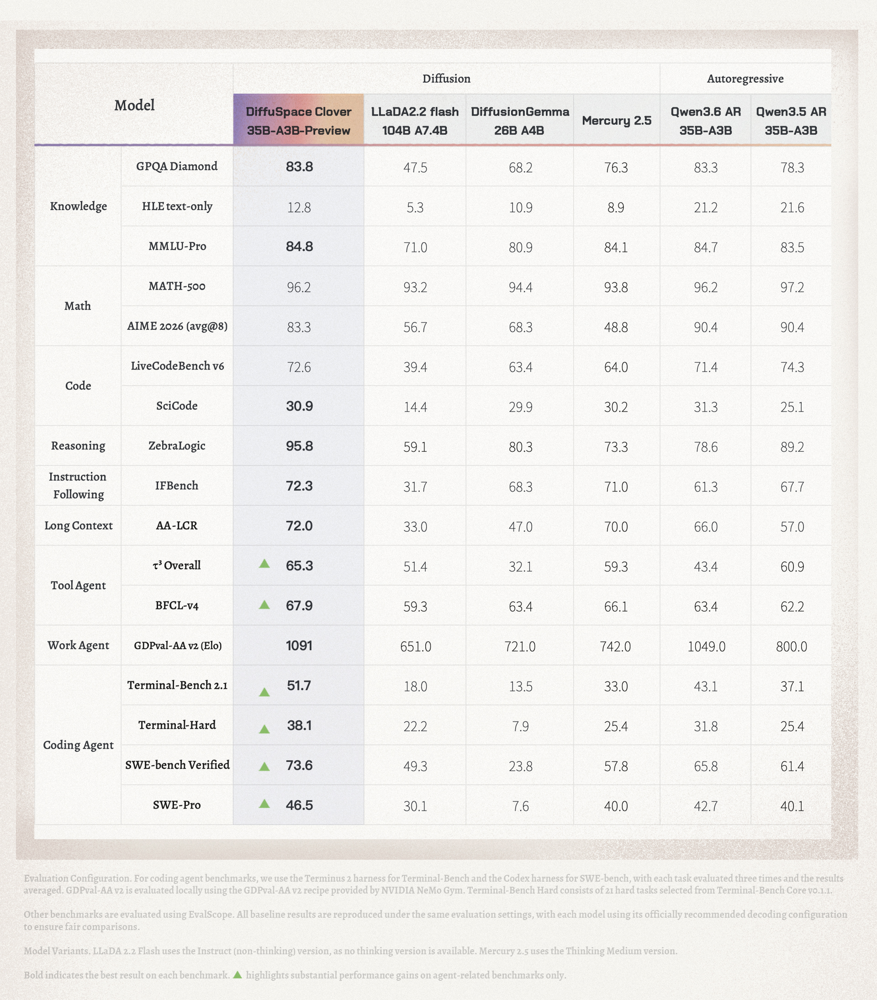
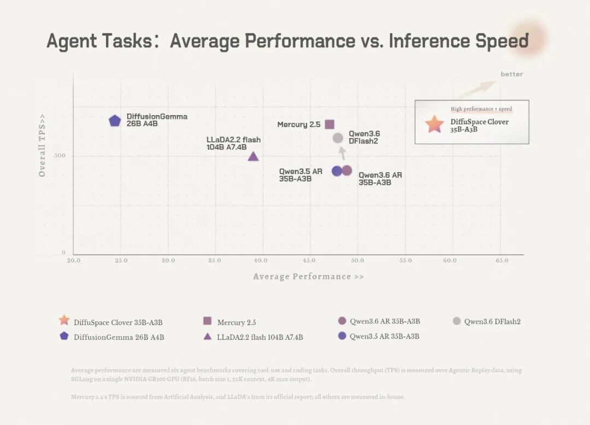
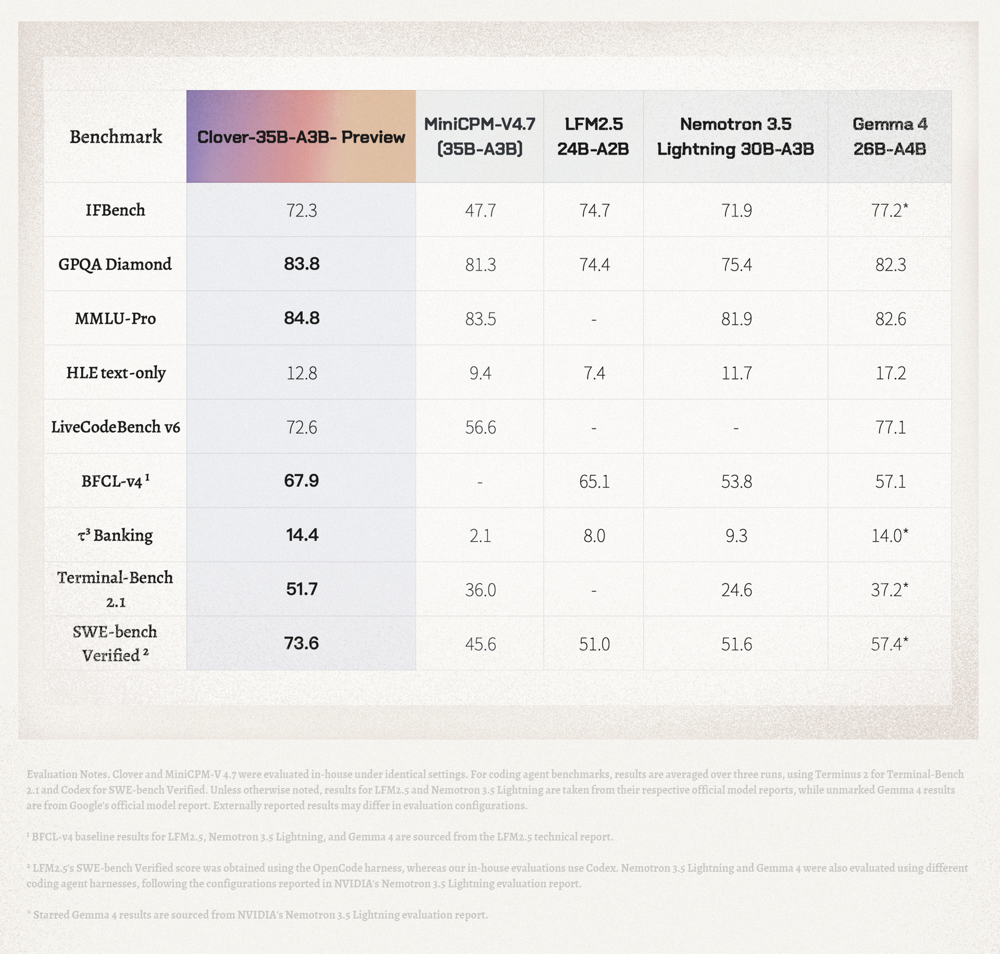
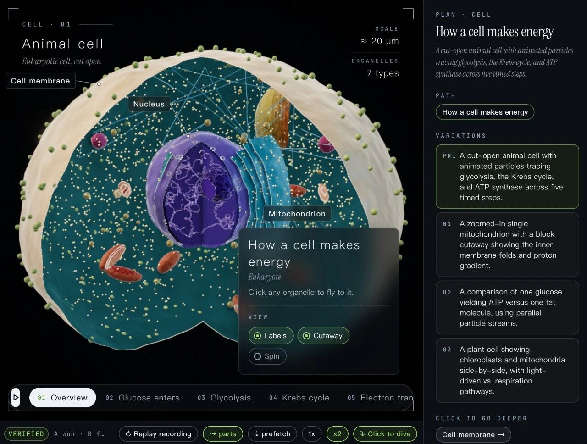
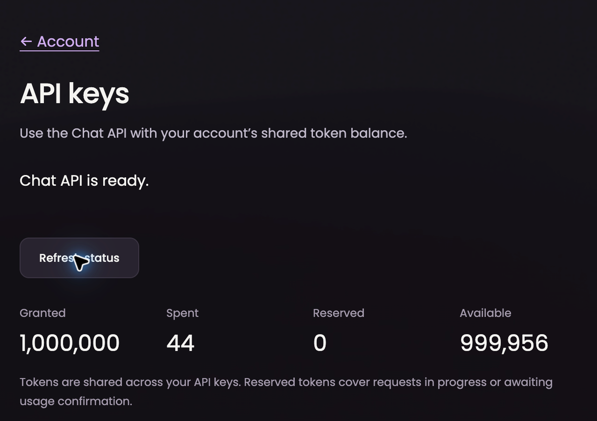

# 【中文版】35B模型发布官方博客

英文版：[【英文版】35B模型发布官方博客](https://xcn9pwg8c442.feishu.cn/wiki/ChrPwIKxFi6WMakyIFIcZCblnwv?from=from_copylink)

# **Clover\-35B\-A3B\-Preview：让智能，多一种生长方式**

> 非常之事，何得循旧。
> 
> 

**今天，我们正式推出DiffuSpace Clover****（三叶）****的第一个版本 35B\-A3B\-Preview。**

2025 年 4 月，香港大学自然语言处理实验室（HKU NLP）推出Dream 7B（[https://hkunlp\.github\.io/blog/2025/dream/](https://hkunlp.github.io/blog/2025/dream/)），至今Dream系列模型累计在Hugginface下载量270万\+次。从Dream出发，扩散智能 DiffuSpace 成为团队成员新的起点，但开源普惠的初衷一直没有改变。

如果说 Dream 7B 证明了扩散语言模型能够与自回归模型正面交锋，那么 Clover 要回答的是一个更根本的问题：当参数走向更大规模，扩散语言模型能否依然保持竞争力，同时守住全局生成的速度优势？

**Clover\-35B\-A3B\-Preview 给出了肯定答案：在更大规模上，扩散语言模型甚至能比同尺寸自回归模型略胜一筹，同时保持更快生成速度。高速生成与高性能，可以共存于同一模型。**

Clover\-35B\-A3B\-Preview 是一个采用混合专家架构（MoE）的扩散语言模型，总参数 350 亿、激活参数 30 亿，支持思考模式。在多项基准测试中，它的性能超过同规模自回归模型 Qwen3\.6\-35B\-A3B，且生成速度显著更快。

Clover\-35B\-A3B\-Preview 在智能体编程与工具使用任务中表现尤为突出。在本次对比的六项 Agent 评测中，它均取得了所列模型中的最高分。其中，SWE\-bench Verified 达到 73\.6，Terminal\-Bench 2\.1 达到 51\.7，τ³ Overall 达到 65\.3，超过了 同为扩散语言模型的 LLaDA2\.2 flash、Mercury 2\.5，以及同尺寸的自回归模型 Qwen3\.6\-35B\-A3B 和 Qwen3\.5\-35B\-A3B。

Clover\-35B\-A3B\-Preview 的通用能力同样扎实。在指令遵循、知识、逻辑推理和长文本理解等多项评测中，其成绩达到或超过同规模自回归模型，GPQA Diamond、ZebraLogic 和 AA\-LCR 分别达到 83\.8、95\.8 和 72\.0。

在推理效率方面，Clover\-35B\-A3B\-Preview 在单张 NVIDIA GB300 GPU 上，以 BF16 精度、batch size = 1 进行测试，在内部Agent 场景数据中实现了 680 tokens/s 的整体生成速度。 即使与采用 DFlash2 加速的同规模 Qwen 模型相比，Clover 仍展现出更优的性能与推理速度的平衡。此外，在单张 NVIDIA H200 GPU 上，Clover 在 Agent 任务中达到 515 tokens/s，高于 DFlash2 方案的 365 tokens/s。以上结果都体现了扩散架构在复杂 Agent 场景下的速度优势。

在 Clover\-35B\-A3B\-Preview 的基础上，我们将继续推进扩散语言模型的规模化研究，提升模型能力与推理速度，并在更广泛的真实任务中验证和改进模型。

Clover\-35B\-A3B\-Preview 现已开源，采用 Apache 许可。模型权重与相关代码已在 Hugging Face 和 GitHub 发布，支持 SGLang 和 llama\.cpp 推理。开发者可下载部署、构建应用，并在 Clover 的基础上开展进一步研究。我们期待与社区一起，拓展扩散语言模型的能力边界。

**相关链接：**
HuggingFace：[https://huggingface\.co/Diffuspace/Clover\-35B\-A3B\-Preview](https://huggingface.co/Diffuspace/Clover-35B-A3B-Preview)

GitHub：[https://github\.com/DiffuSpace/Clover\-35B\-A3B\-Preview](https://huggingface.co/Diffuspace/Clover-35B-A3B-Preview)

ModelScope：[https://modelscope\.cn/models/Diffuspace/Clover\-35B\-A3B\-Preview](https://huggingface.co/Diffuspace/Clover-35B-A3B-Preview)

申请在线体验：https://chat\.diffuspace\.ai/

## 扩散，向更大的可能

支撑这次跃迁的，不只是参数规模，还有我们围绕块扩散（Block Diffusion）对门控 Delta 网络（Gated DeltaNet，GDN）的结构性重构。

我们重新设计了双向门控 Delta 网络（Bidirectional GDN），让历史记忆与块内去噪各自采用适合的计算方式：已生成的上下文通过 GDN 的递归状态（recurrent state）高效压缩，当前块内的 token 则通过双向 Softmax 注意力（bidirectional softmax attention）进行细粒度交互。关键之处在于，我们把历史记忆的读出作为一个独立的信息单元（information unit），与块内 token 放在同一次 Softmax 中共同参与信息选择，让模型自己学习何时依赖历史、何时利用当前块。我们还引入可学习的块大小校准（learnable block\-size calibration），补偿块内 token 增多时对历史权重的天然稀释。在局部特征提取上，我们为右侧上下文设置独立、零初始化的卷积分支（zero\-initialized convolution branch），让模型从预训练的因果卷积（causal convolution）行为出发，直接学习左右方向各自的特征。

由此，紧凑的长程记忆、具有选择性的块内交互与双向局部感知被结合起来，使 GDN 的结构更贴合块级并行去噪（block\-level parallel denoising）。Clover\-35B\-A3B\-Preview 的高速与高性能，正来自这些结构层面的针对性设计。

## Agentic coding

Clover\-35B\-A3B\-Preview 在 Agentic Coding 能力上不止是代码补全，它可以将自然语言需求直接转化为完整、可交互的应用，也能在真实浏览器环境中理解页面并连续完成多步操作。

在智能体中，速度本身就是一种核心能力。智能体需要在决策、执行、反馈与调整之间持续循环，每一次生成延迟都会沿着任务链路不断累积。Clover 更快的生成速度缩短了这条反馈回路：开发者可以更早看到应用预览，智能体也能更及时地根据执行结果调整策略、推进下一步。当每一步都更快，智能体就能在同样的时间里探索更多路径，并更早抵达结果。

## 端侧应用

端侧要的不是“慢思考”，而是快而全局的判断。

在端侧部署方面，Clover 已成功在仅配备 16GB 显存的 NVIDIA RTX 5070 Ti 上实现 INT4 量化部署。在 MATH\-500 测试中，Clover 的生成速度达到 101\.8 tokens/s，相比同规模 MiniCPM、Qwen 等模型的对照测试结果（48\.5 tokens/s）表现出显著的效率优势。团队将持续优化推理引擎与端侧部署方案，进一步释放扩散语言模型在资源受限设备上的性能潜力。

性能上，与 MiniCPM\-V 4\.7（35B\-A3B）、LFM2\.5（24B\-A2B）、Nemotron 3\.5 Lightning（30B\-A3B）和 Gemma 4（26B\-A4B）等代表性轻量级、高效推理或端侧部署模型的对比中，Clover\-35B\-A3B\-Preview 在九项评测中的六项取得最高分，优势覆盖知识推理、工具使用与智能体编程。其中，Terminal\-Bench 2\.1 达到 51\.7，SWE\-bench Verified 达到 73\.6，分别比同为 35B\-A3B 的 MiniCPM\-V 4\.7 高出 15\.7 和 28\.0 分；BFCL\-v4 和 τ³ Banking 分别达到 67\.9 和 14\.4；GPQA Diamond 和 MMLU\-Pro 分别达到 83\.8 和 84\.8。

## Demo展示

### 路径规划

> 在此案例中用户要查询“从匹兹堡 CMU 到最近的 Wendy’s 需要开车多久”，但地图网站的搜索不带位置信号，直接搜索店名会跳到缅因州 Portland。Clover 识别出结果偏离目标，逐步加入城市、街区和邮编改写检索，并在页面卡住后两次重置、重填路线，最终找到目标门店，查得驾车距离 **2\.0 公里、车程约 3 分钟**。
> 
> 本次对照中，Clover\-35B\-A3B\-Preview 用 28 步、169\.9 秒完成任务；Qwen3\.6 Flash 用满 30 步、耗时 578\.3 秒，仍停留在距起点 347 公里、车程约 4\.5 小时的门店，未通过任务评判。
> 
> 

[导航时间查询\.mp4](图片和附件/导航时间查询.mp4)

### WebMCP：连续完成六项业务任务

> 通过网页提供的工具，模型连续完成开票、课程注册、金额汇总、事件状态与客户信息查询等任务。演示将多个业务页面放在同一视图中，对照工具调用、页面操作和完成结果，两方均通过所选的六项任务。
> 
> 在完整的 **49 项任务、每项 3 次尝试**的评测中，Clover 的 Agent 执行耗时中位数为 **1\.52 秒**，Gemini3\.6 Flash 为 **8\.86 秒。**
> 
> 

[WebMCP\.mp4](图片和附件/WebMCP.mp4)

### 创建私有项目并邀请成员

> 根据一条指令，模型需要创建名为 planner 的私有项目，并添加两名指定成员。这要求它连续完成项目创建、可见性设置、成员查找与邀请，始终保持对用户目标的把握。
> 
> 在相同的智能体框架、提示词、工具和浏览器配置下，本次运行中 Clover\-35B\-A3B\-Preview 用 **13 步、169\.9 秒**完成任务，Qwen3\.6 Flash 用 **21 步、392\.3 秒**完成。
> 
> 

[创建私人项目并添加成员\.mp4](图片和附件/创建私人项目并添加成员.mp4)

### GenUI：用一个 HTML 文件构建交互式桌面

> 该案例中用户要求用单个 HTML 文件模拟一个桌面环境，支持窗口拖动，并能打开多个小应用。Clover 根据这条需求，生成了包含程序坞、窗口系统以及记事本、计算器、时钟、天气和设置等应用的模拟桌面。
> 
> 在演示中，用户可以打开应用、输入文本、操作计算器并调整设置。这一任务同时考察了界面布局、交互逻辑与多个功能模块的代码组织能力，展示了从自然语言需求到可交互应用的生成过程。
> 
> 

[GenUI\-新\.mp4](图片和附件/GenUI-新.mp4)

### 无人机调度：复合报文的并行解析

> 在城市低空无人机调度演示中，模型通常需要将复合空管报文解析为禁飞区解除、航点修改、任务分配、禁飞区半径调整和紧急调度等多项任务。Clover在0\.97秒后同时完成处理呈现五项正确结果  。Qwen在3\.78S展示结果，其中将UAV5的测绘任务误解析为医疗任务。这一案例直观展示了扩散并行生成在复合指令解析中的速度以及任务意图理解的优势。
> 
> 

[无人机\-新\.mp4](图片和附件/无人机-新.mp4)

## 生态伙伴

SigmaZ 是我们在 GenUI 方向的独家生态伙伴。他们把 Clover 的能力带进教育场景，让知识不再只是静态图文，而是可操作、可互动的画面。目前，SigmaZ 已上线教育场景内测 Demo。接下来，我们正着手进行联合后训练，计划把 token 吞吐量提升到 2000 tokens 每秒，把实时视觉编码应用到更加通用的实时交互场景。

### 3D 科普：走进细胞的能量工厂

> 围绕“细胞如何产生能量”，模型构建了一个可交互的 3D 科普页面。页面以剖面形式展示动物细胞。用户可以点击细胞器拉近查看说明，也能切换结构标签、剖面和旋转视角，从细胞整体逐步深入到局部。该案例把知识讲解、三维场景与交互逻辑放在同一个页面里，让“葡萄糖如何变成细胞能量”不再只是文字描述，而是可以通过观察和操作来理解的过程。
> 
> 
> 
> 

### 交互式天文科普：让日月食的成因看得见

> 围绕“为什么日月食并不每月发生”，模型构建了一个随时间变化的太阳—地球—月球 3D 演示页面，将天体位置、月球轨道倾角与月相变化放进同一个场景，让用户直观看到日月食所需的特殊排列条件。
> 
> 用户可以拖动时间轴，观察三者的相对运动，也可以切换轨道、标签与阴影锥的显示，或跳转到日食发生时刻，查看月球阴影如何落到地球上。页面还标注了距离压缩与尺寸调整，兼顾演示的可读性和科学概念的准确表达。
> 
> 

## 决策模型

我们同时推出 Clover\-35B\-A3B\-Preview 的决策模型，面向快速、结构化的判断任务，将在后续发布。

模型支持两种作答方式：

独立模式：逐题调用，每次只回答一个问题，适合孤立或常规的快速判断；

联合模式：将同一份材料下的多个问题放在一起，在同一次去噪过程中并行生成答案（每次最多 8 个）。

和TypeSafe Jev或其他开源决策模型不同的是，相比于单点处理，联合模式的优势在于“全局统筹”：它不仅大幅减少了多次交互的时间，更能让多个判断在生成过程中相互参照、避免逻辑冲突。一次处理多个关联决策，不仅更快，还更准。

在包含 500 组、2420 道关联问题的内部验证中，联合模式答对了 95\.0% 的问题，并在 80\.4% 的问题组中全部答对。相比之下，同一模型独立作答时，两项成绩分别为 89\.8% 和 62\.4%；TypeSafe 的决策模型 Jev 在相同题目的历史评测中分别为 63\.6% 和 15\.8%。在本次验证中，把关联问题放在一起处理，同时提高了单题准确率与整组答案的正确率。

### 同一份合同，五个关联判断

> 同一份合同中的“通知是否及时”和“保证金是否应保留”存在规则上的依赖。逐题独立判断时，模型可能一边认为通知超时，一边又选择只有通知及时才允许的“保留保证金”。联合模式让这两个判断一起生成，有助于减少前后矛盾，也减少了重复读取材料和逐题调用的开销。
> 
> 在该验证案例中，联合模式的 5 项判断全部正确，独立模式答对 4 项，Jev 答对 2 项。演示对照了通知时限、保证金保留等判断，展示联合模式如何处理相互依赖的规则。
> 
> 

[合同验收与补救（demo）\.mp4](图片和附件/合同验收与补救（demo）.mp4)

### 中国象棋：根据棋局连续决策

> 决策模型读取当前棋盘状态，选择下一步，并输出结构化落子动作。在这局与TypeSafe Jev 的对弈中，DiffuSpace 的决策模型执黑获胜。
> 
> 

[Jev象棋PK\.mp4](图片和附件/Jev象棋PK.mp4)

## 下一步

接下来，我们将持续推进扩散语言模型的规模化，并拓展多模态能力；同时提升长程任务中的稳定性，优化推理效率，推进量化与端侧适配。

同时，我们也在开发智能体运行框架（harness）与编程客户端（desktop），将需求输入、工具调用、任务执行和结果查看连接起来。相关工具仍在开发中，将在近期上线。

[cli\.mp4](图片和附件/cli.mp4)

[desktop\-新\.mp4](图片和附件/desktop-新.mp4)

这些工作离不开开源社区打下的基础。感谢 Qwen 开放的模型架构与训练生态，让 Clover\-35B\-A3B\-Preview 的研究有了可靠起点；感谢 SGLang 社区在块扩散推理路径上的工程支持；也感谢 llama\.cpp 社区开放的适配接口与协作流程。

欢迎大家前往 diffuspace\.ai 申请内测体验 Clover\-35B\-A3B\-Preview。

同时，开发者可在 Hugging Face 与 ModelScope 下载模型权重、构建应用，或在 GitHub 提交 Issue、参与适配。来自真实任务的反馈，将帮助我们持续优化。我们期待与开源社区一起共建，也相信扩散模型会因此变得更好。

我们也欢迎各类场景的生态合作方加入，一起把扩散语言模型带进真实任务，共同验证、共同打磨。

Clover（三叶草）代表幸运，也承载着我们对扩散模型的期待。

今天，Clover 破土而出，向智能的旷野蔓延生长。

